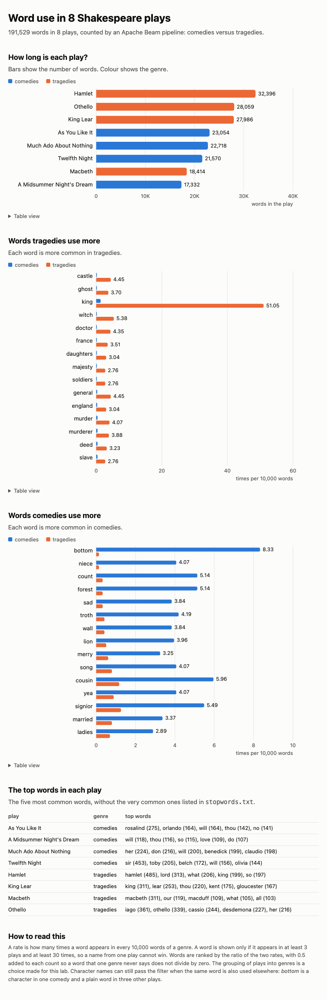

# Apache Beam Lab – Word Count on King Lear, and Eight Plays

[](https://colab.research.google.com/github/1AlgoRythm/mlops-lab3/blob/main/LAB3.ipynb)

A notebook that extends the course's Apache Beam lab. Beam is a library for writing data pipelines.
A pipeline runs on a "runner", the engine that executes it, and Beam has several runners.

The lab counts the words in Shakespeare's *King Lear*. This notebook keeps that lab and then does
more. It fixes the flaws of the word count, adds a second dataset of eight plays, compares the
plays and two genres with a second pipeline, and builds an HTML dashboard of the results. It also
asks who speaks the most in each play, and how long the words are.

Based on `Labs/Data_Labs/Apache_Beam_Labs` from https://github.com/raminmohammadi/MLOps
(MLOps, DADS 7305, Northeastern University). The notebook is `LAB3.ipynb`. It is the
lab's own `Try_Apache_Beam_Python.ipynb`, renamed. Its first six cells are the course's own and are
unchanged.

## Contents

- [Overview](#overview)
- [Comparing the plays](#comparing-the-plays)
- [Who speaks, and how long are the words?](#who-speaks-and-how-long-are-the-words)
- [Requirements](#requirements)
- [Installation](#installation)
- [Usage](#usage)
- [Project Structure](#project-structure)
- [API Reference](#api-reference)
- [Changes From the Upstream Lab](#changes-from-the-upstream-lab)
- [Known Limitations](#known-limitations)
- [Lessons Learned](#lessons-learned)

## Overview

The notebook has two parts.

| Cells | What they are |
|---|---|
| The first six | The course's lab: set up, and a word count of *King Lear*. Unchanged. |
| Part 2, section 1 | The flaws of the lab's word count, shown with numbers from its own output |
| Part 2, section 2 | A fixed word count: lower case, a sorted CSV, `top_n`, stopwords, an input check, run counters |
| Part 2, section 3 | A second dataset: eight plays, downloaded and checked against checksums |
| Part 2, section 4 | A second pipeline that compares the plays and two genres |
| Part 2, section 5 | A dashboard: one self-contained HTML page with charts |
| Part 2, section 6 | Who speaks the most in each play, and how long the words are |

The fixed word count is a chain of steps. Beam calls the data that flows between steps a
`PCollection`. The steps run in this order:

1. `Read lines`: reads `data/kinglear.txt` (5,525 lines).
2. `Find words`: splits each line into lower-case words and counts lines and words as it goes.
3. `Drop stopwords`: removes the words in an optional stopword file.
4. `Pair words with 1`, then `Group and sum`: counts each word.
5. `Gather pairs`, then `Sort by count`: puts all pairs in one list, sorted by count.
6. `Make CSV body`, then `Write results`: writes `outputs/word_counts.csv`.

On the whole play there are 27,986 words and 4,176 different words. The most common are `the`
(910), `and` (738) and `i` (652).

## Comparing the plays

Section 4 of the notebook is a second pipeline. It reads the files in `plays/`: four tragedies and
four comedies, one text file per play. The name of the folder is the genre. The files come from the
same public bucket as the lab's own data. Section 3 downloads them from
`https://storage.googleapis.com/dataflow-samples/shakespeare/` and checks each file against a SHA-256
checksum that is written in the notebook.

The pipeline writes three CSV files to `outputs/`:

| File | What it holds |
|---|---|
| `play_stats.csv` | Words, different words, and different words per word said, for each play |
| `play_top_words.csv` | The ten most common words of each play, without stopwords |
| `genre_words.csv` | The 15 words that tragedies use most compared with comedies, and the 15 for comedies |

Section 5 turns them into a report. This is how it looks, in a picture saved from the page:



Beam ideas that this pipeline adds to the lab's word count:

1. `ReadFromTextWithFilename` gives each line together with its file name. The name gives the genre
   and the play.
2. `Count.PerElement` counts each `(genre, play, word)`.
3. `PlayStats` is a custom combiner. It folds the counts of one play into two numbers: the words and
   the different words.
4. The total number of words in each genre reaches every word through a side input, which is a
   small result that Beam hands to every worker.
5. `WriteCsv` is a composite transform. It gathers rows, sorts them and writes one CSV file.

The plays, longest first:

| Play | Genre | Words | Different words | Different per word said |
|---|---|---|---|---|
| Hamlet | tragedies | 32,396 | 4,728 | 0.1459 |
| Othello | tragedies | 28,059 | 3,801 | 0.1355 |
| King Lear | tragedies | 27,986 | 4,176 | 0.1492 |
| As You Like It | comedies | 23,054 | 3,272 | 0.1419 |
| Much Ado About Nothing | comedies | 22,718 | 2,979 | 0.1311 |
| Twelfth Night | comedies | 21,570 | 3,118 | 0.1446 |
| Macbeth | tragedies | 18,414 | 3,358 | 0.1824 |
| A Midsummer Night's Dream | comedies | 17,332 | 3,005 | 0.1734 |

Tragedies and comedies use different words. Each pair shows how often the word appears per 10,000
words in tragedies, then in comedies:

- **More in tragedies:** `castle` (4.45 and 0.06), `ghost` (3.70 and 0.06), `king` (51.05 and 1.36),
  `witch` (5.38 and 0.18) and `doctor` (4.35 and 0.18).
- **More in comedies:** `bottom` (0.14 and 8.33), `niece` (0.14 and 4.07), `count` (0.33 and 5.14),
  `forest` (0.33 and 5.14) and `sad` (0.33 and 3.84).

Not every word on the comedy list is a plain word. `bottom` is a character: 67 of its 70 uses in the
comedies are in *A Midsummer Night's Dream*. `count` is often a noble title, as in "Count Claudio"
and "Count Orsino".

## Who speaks, and how long are the words?

Section 6 of the notebook asks two more questions of the same eight plays. Each has its own pipeline.

**Who speaks the most?** A play file starts each speech with `NAME<tab>words`, and the next lines of
the same speech are indented. Stage directions are in `[brackets]`, and every scene begins with an
`ACT` line and a `SCENE` line. The cast list before the first `ACT I` has the same `NAME<tab>words`
shape, so the parser skips it. A speech runs over many lines, so the pipeline reads each whole play
as one element, with `fileio.MatchFiles` and `fileio.ReadMatches`, and splits it into speeches. It
counts the speeches and the spoken words of each character, without stage directions.

The speaker with the most speeches in each play:

| Play | Speaker with most speeches | Speeches | Words |
|---|---|---|---|
| As You Like It | Rosalind | 201 | 5,737 |
| A Midsummer Night's Dream | Bottom | 50 | 1,691 |
| Much Ado About Nothing | Don Pedro | 135 | 2,485 |
| Twelfth Night | Sir Toby Belch | 152 | 2,705 |
| Hamlet | Hamlet | 359 | 11,649 |
| King Lear | King Lear | 187 | 5,612 |
| Macbeth | Macbeth | 146 | 5,350 |
| Othello | Othello | 274 | 6,256 |

Iago speaks less often than Othello (272 speeches against 274) but says more words (8,411 against
6,256).

**How long are the words?** Every word is measured, and each length is counted as a percent of the
genre's words. Words of 15 letters or more are pooled. Words of 6 letters or more make up 17,785 of
84,674 words in the comedies (21.0%) and 24,662 of 106,855 words in the tragedies (23.1%).

## Requirements

- Python 3.12 or 3.13. Apache Beam 2.77 lists Python 3.10 to 3.14.
- A place to run a notebook: Jupyter, VS Code or Google Colab.
- The packages in `requirements.txt`: `apache-beam`, and `pandas` in the range 1.4.3 up to 2.4,
  because Beam needs pandas inside a notebook.
- Run with Python 3.12.15 and 3.13.16, Apache Beam 2.77.0 and pandas 2.3.3.

## Installation

```bash
git clone https://github.com/1AlgoRythm/mlops-lab3.git
cd mlops-lab3
python3.12 -m venv .venv
source .venv/bin/activate
pip install -r requirements.txt
```

## Usage

Open `LAB3.ipynb` and run all the cells from top to bottom. In Colab, use
*Runtime, Run all*. The notebook's own setup cell installs `apache-beam`, and a pandas that Beam
accepts, when they are missing.

Running the notebook has these effects:

- The lab's own word count rewrites `outputs/part-00000-of-00001`, with the same counts.
- The fixed word count writes `outputs/word_counts.csv` and `outputs/word_counts_no_stopwords.csv`.
- Section 2 writes `stopwords.txt`, a list of 25 very common words, when it is missing.
- Section 3 downloads the eight plays into `plays/` when they are missing.
- Section 4 writes the three CSV files, and section 5 writes `outputs/report.html`.
- Section 6 writes `outputs/speakers.csv` and `outputs/word_lengths.csv`.

The three functions that do the work are in cells of the notebook, and you can call them with your
own input:

| Function | Parameters | What it does |
|---|---|---|
| `run_wordcount` | `inputs_pattern='data/*'`, `outputs_prefix='outputs/word_counts'`, `top_n=20`, `stopwords_path=None` | Runs the fixed word count and returns its counters. `top_n=0` keeps every word. |
| `run_compare` | `inputs_pattern='plays/*/*.txt'`, `output_dir='outputs'`, `stopwords_path='stopwords.txt'`, `top_n=10`, `genre_top_n=15`, `min_plays=3`, `min_count=30` | Writes the three CSV files |
| `build_report` | `output_dir='outputs'` | Reads the three CSV files, writes `report.html` and returns the page |
| `run_speakers` | `inputs_pattern='plays/*/*.txt'`, `output_dir='outputs'`, `top_n=5` | Writes the top speakers of each play |
| `run_word_lengths` | `inputs_pattern='plays/*/*.txt'`, `output_dir='outputs'`, `longest=15` | Writes the share of each word length in each genre |

For example, the eight most common words of *King Lear* without the very common ones:

```python
run_wordcount('data/*', 'outputs/word_counts_no_stopwords', top_n=8, stopwords_path='stopwords.txt')
```

This gives `king` (311), `lear` (253), `thou` (220), `kent` (175), `gloucester` (167), `thy` (161),
`no` (154) and `so` (141). The call returns the three counters of the run:
`{'lines': 5525, 'lines_without_words': 1665, 'words': 27986}`.

If the input is missing or empty, the functions raise `ValueError` with a clear message and write no
output file.

## Project Structure

```
.
├── LAB3.ipynb                    the lab notebook: the course's cells, then Part 2
├── data/kinglear.txt             the input text (from the original lab)
├── docs/report.png               a picture of the dashboard
├── requirements.txt
└── .gitignore
```

Running the notebook creates `plays/` (the eight plays), `outputs/` (the results) and `stopwords.txt`.
They are not kept in the repository.

## API Reference

These names are defined in cells of the notebook.

| Name | What it does |
|---|---|
| `find_words(line)` | Returns the lower-case words of one line |
| `FindWords` | The Beam step that uses `find_words` and keeps three counters |
| `rank(word_counts, top_n=0)` | Sorts `(word, count)` pairs, highest count first, then by word |
| `to_csv(ranked)` | Makes the CSV lines, `word,count` |
| `check_input(pattern)` | Raises `ValueError` if no file matches or every file is empty |
| `load_stopwords(path)` | Reads a stopword file into a set |
| `build_wordcount_pipeline(...)` | Adds all the steps of the word count to a Beam pipeline |
| `play_key(path)` | Returns `(genre, play)` from a path such as `plays/tragedies/hamlet.txt` |
| `find_genres(pattern)` | Returns the two genre folder names, or raises `ValueError` if there are not exactly two |
| `PlayStats` | The custom combiner: counts to `(words, different words)` |
| `genre_rows(...)` | Scores one word: rate per 10,000 words in each genre, and their ratio |
| `pick_extremes(rows, top_n)` | Keeps the words that favour each genre most |
| `WriteCsv` | The composite transform that gathers, sorts and writes one CSV |
| `build_compare_pipeline(...)` | Adds all the steps of the comparison to a Beam pipeline |
| `render(...)` | Builds the whole HTML page from the three CSV files |
| `parse_speeches(text)` | Returns `(speaker, words)` for each speech in a whole play |
| `count_spoken(text)` | Counts the words in some speech, without stage directions |
| `read_whole_play(file)` | Turns a file into one `(path, text)` element |
| `top_speakers(play, speakers, top_n)` | Ranks the speakers of one play, most speeches first |
| `build_speakers_pipeline(...)` | Adds the speaker steps to a Beam pipeline |
| `build_word_lengths_pipeline(...)` | Adds the word-length steps to a Beam pipeline |

A word is letters, with single apostrophes allowed inside it:

```python
find_words("The KING doesn't say 'tis so")      # ['the', 'king', "doesn't", 'say', 'tis', 'so']
rank([('b', 2), ('a', 2), ('c', 5)])            # [('c', 5), ('a', 2), ('b', 2)]
rank([('b', 2), ('a', 2), ('c', 5)], 2)         # [('c', 5), ('a', 2)]
to_csv([('the', 9), ('of', 4)])                 # 'the,9\nof,4'
```

## Changes From the Upstream Lab

Each change is its own commit.

### Fixed

- **Upper and lower case were different words.** The lab counted `the` 786 times and `The` 122
  times. Words are now lower-cased, so `the` is 908 before the next fix. The 4,784 different
  "words" became 4,215.
- **A quote mark was counted as a word.** The lab counted a lone `'` 15 times, and counted
  `'tis` and `tis` apart. A word is now letters with apostrophes only inside it. The count of
  different words is 4,176.
- **The output was Python's text form of a tuple,** such as `('KING', 243)`, in no order. It is
  now a CSV file with a header, sorted by count and then by word.
- **A comment and its command disagreed.** The lab's comment says "first 20 results", and the command
  prints 200. The original cell is left as it is, and the new code uses `top_n`, which defaults to 20.

### Added

- **Part 2 of the notebook,** in six sections that are listed in the [Overview](#overview).
- **A second dataset and a second pipeline.** Eight plays from the lab's own bucket, and a pipeline
  that reports on each play and on the two genres. It uses a custom combiner, a side input, grouping
  by key and a composite transform.
- **A dashboard.** A self-contained HTML page with inline SVG charts, a light and a dark mode,
  tooltips and a table view of every chart.
- **Options:** `top_n` and an optional stopword file.
- **An input check** that stops with a clear message.
- **Three counters** with Beam's metrics: lines, lines without words, and words. They matched
  independent counts of the file: 5,525 lines, 1,665 lines with no letter, and 27,986 words
  (the sum of all the counts).
- **A setup cell** that installs `apache-beam` and a compatible pandas when they are missing.
- **A `requirements.txt`.**
- **A speaker analysis and a word-length analysis,** section 6. Each play is read as one element, and a character's speeches and spoken words are counted from the layout of the file.

### Changed

- Nothing in the first six cells of the notebook. The data file is byte-identical to the course
  repository. The original word count writes `outputs/part-00000-of-00001` when it runs.

## Known Limitations

- **Not run in Colab.** The notebook was run in a Jupyter kernel on Python 3.12 and 3.13. The setup
  cell is meant to make it work in Colab, but that was not tried. The picture in the last cell shows
  as a broken image when the notebook runs without the `docs/` folder.
- **All the pairs are gathered on one worker to sort them.** Beam does not promise any order,
  so the pipeline puts every word in one list. This is fine for one play and would not scale to
  a large text.
- **Only the letters `a` to `z` count as letters.** An accented letter splits a word, so `café`
  becomes `caf`. The *King Lear* file has no such letters, so it does not change these results.
- **The stopword list is short and chosen for this lab.** It is not a standard list. Words like
  `thou` and `thy` stay in the results.
- **Eight plays are a small sample.** Another choice of plays would give other words.
- **Names and titles can pass the filter.** `bottom` is a character, and `count` is often a title.
  The cast lists and speaker names are in the text, so a play's own name leads its top words: `hamlet`
  (485) in *Hamlet* and `macbeth` (311) in *Macbeth*.
- **Different words per word said depends on length.** The two shortest plays, *Macbeth* and *A
  Midsummer Night's Dream*, have the two highest values. Compare it only between plays of similar
  length.
- **One-letter words are left out of the genre comparison.** Without that rule, `t` (from `'t`, which
  is "it" with an apostrophe in front) appeared 34 times in the plays.
- **The dashboard was checked in Chrome only,** in light and dark mode. A bar smaller than 1.5 pixels is
  drawn 1.5 pixels wide, so a tiny value stays visible. The tooltip and the table give the exact value.
  The notebook shows the page inside a frame, and a viewer such as GitHub may not show frames. That is
  why a saved picture of the page follows it.
- **The comparison needs exactly two genre folders.** `run_compare` raises `ValueError` otherwise.
- **The packages are not pinned,** except that pandas must be older than 2.4. The versions used are
  listed under [Requirements](#requirements).
- **The runner is Beam's default.** In Beam 2.77 it is `SwitchingDirectRunner`, and the log of
  this pipeline shows `PrismRunner`. Another Beam version may choose differently.
- **Speaker names are the labels in the files.** `Lear` and `King Lear` can name the same person, and
  the analysis counts each label it finds. Names are written in title case, with no colon at the end.
- **The speaker analysis depends on the layout of the files:** `NAME<tab>words`, and `ACT` and `SCENE`
  lines. A text with another layout would need another parser. Spoken words leave out the stage
  directions.

## Lessons Learned

- Beam is a chain of steps on a `PCollection`, written as `pipeline | 'name' >> step`. Each step
  gets a name.
- Beam gives no promise about order. The lab's own output was in no order, and a sort needs all
  the pairs in one place. Gathering them into one list and sorting it did that, at the cost of
  one worker.
- Counters live inside the steps and are read from the result after the run. They matched
  independent counts of the file, which showed that the word-splitting step saw every line.
- The default local runner is not the one the notebook names. The notebook says
  `DirectRunner`. Beam 2.77's default is `SwitchingDirectRunner`, and the log of this pipeline
  showed Prism running it.
- A pipeline that ran is not a pipeline that is right. The lab ran fine and still counted
  `The` and `the` apart and counted a quote mark 15 times. Check the output, not only the exit
  code.
- A custom combiner has four methods: make an empty total, add one input, merge two totals, and
  produce the answer. The merge method exists because Beam may split the work and join the parts.
- A side input is a small result that every worker can read. The genre totals are one, and each word
  uses them to compute its rate.
- Beam refused a side input on `FlatMapTuple` with "Side inputs must have defaults for FlatMapTuple".
  A plain `FlatMap` with a small wrapper function worked.
- Inside a notebook, importing Beam also imports pandas. With pandas 3.1.0 the import failed with
  "type object 'DataFrame' has no attribute 'first'". Beam's own package data asks for pandas older
  than 2.4, and with pandas 2.3.3 it worked. Read what a library declares that it supports.
- Look at what you build. The first picture of the dashboard showed pale text on a white page, because
  the colour variables were defined below the element that set the page background. A long play title
  was also cut off. Only looking at the picture found both.
- The output can show a flaw in a rule. The token `t` came from my own rule that drops edge
  apostrophes. A one-letter filter in the comparison fixed it.
